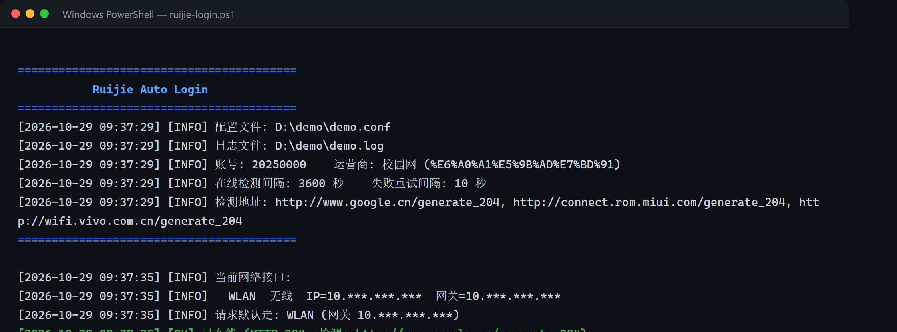

<p align="center">
  
</p>

<h1 align="center">Ruijie Auto Login</h1>

<p align="center">
  成都信息工程大学校园网（锐捷 ePortal）自动登录工具<br>
  Windows PowerShell · Linux / WSL Shell · Go
</p>

<p align="center">
  <a href="https://github.com/cuit-edu-cn/ruijie-auto-login">原项目</a> ·
  <a href="#quick-start">快速开始</a> ·
  <a href="#config">配置</a> ·
  <a href="#attribution">改编说明</a> ·
  <a href="CONTRIBUTING.md">参与贡献</a> ·
  <a href="docs/BRANCHING.md">分支模型</a> ·
  <a href="CHANGELOG.md">更新日志</a>
</p>

---

## 1 简介

校园网每次连接都要弹出网页登录认证。本项目可以在不打开网页的情况下自动完成锐捷 ePortal 认证，适合开机自启或后台常驻。

本项目改编自 [cuit-edu-cn/ruijie-auto-login](https://github.com/cuit-edu-cn/ruijie-auto-login)。在原 Shell / Go 版本的基础上，增加了 Windows PowerShell 原生版本、首次运行交互式初始化、运营商适配和更清晰的日志。

> **项目状态**：v1.0.0，已在 Windows 10/11 + PowerShell 5.1 环境验证。Linux / WSL 与 Go 版本沿用上游实现。

### 运行效果

<p align="center">
  
</p>

<hr>

## 2 特性

- ✅ Windows 原生 PowerShell 版本，不依赖 WSL / Git Bash
- ✅ 首次运行自动询问学号、密码、运营商，写入配置，之后直接运行
- ✅ 有线 / 无线网络自动识别，显示当前接口和默认路由
- ✅ 支持移动、联通、电信、校园网（含移动编码修复）
- ✅ 掉线自动重新登录，失败后按间隔重试
- ✅ 控制台 + 文件双日志，过程清晰
- ✅ 配置模板化，真实账号密码不进入 Git

## 3 快速开始 <a name="quick-start"></a>

### 3.1 Windows PowerShell（推荐）

1. 下载 / clone 本项目。
2. 双击 `ruijie.bat`，或在仓库根目录打开 PowerShell：

   ```powershell
   powershell -NoProfile -ExecutionPolicy Bypass -File .\ruijie-login.ps1
   ```

3. 首次运行会依次提示输入：
   - 学号 / 账号
   - 密码（输入时不回显）
   - 运营商（`1` 移动 / `2` 联通 / `3` 电信 / `0` 校园网）

   输入完成后会自动写入 `shell/ruijie.conf`，然后直接开始运行。

4. 以后再次双击 `ruijie.bat` 即可，不再询问。

其他用法：

```powershell
# 只检测/登录一次后退出，方便调试
powershell -NoProfile -ExecutionPolicy Bypass -File .\ruijie-login.ps1 -Once

# 指定检测地址（调试用）
powershell -NoProfile -ExecutionPolicy Bypass -File .\ruijie-login.ps1 -Once -DetectUrl "http://www.google.cn/generate_204"
```

开机自启：给 `ruijie.bat` 建一个快捷方式，放到启动目录（Win+R 输入 `shell:startup` 回车）即可。

### 3.2 Linux / WSL Shell

```bash
cd shell
bash ./ruijie-login.sh

# 后台常驻
nohup bash ./ruijie-login.sh >/dev/null 2>&1 &
```

首次运行会自动把 `ruijie.conf.example` 复制成 `ruijie.conf` 并提示填写；填写后再次运行即可。

### 3.3 Go

`auto_login/` 是原项目的 Go 实现，本仓库未改动其逻辑。配置 `configuration.yaml` 后编译运行：

```
UserId:             用户名
Password:           用户密码
Server:             网络服务商，可选参数：
                    移动: 1 | 移动 | yd
                    联通: 2 | 联通 | lt
                    电信: 3 | 电信 | dx
                    校园网: 0 | 教育网 | 校园网 | edu
TimeInterval: 600   时间间隔（秒）
LogPath:            日志文件相对路径（默认 ruijie.log）
LogClearDay: 7      日志清除时间（天）
```

Go 版本的依赖和构建方式请参考原项目。Windows 下推荐直接使用上面的 PowerShell 版本。

## 4 配置说明 <a name="config"></a>

配置文件：`shell/ruijie.conf`

- 该文件已被 `.gitignore` 忽略，**不要提交你的真实账号密码**。
- 模板文件：`shell/ruijie.conf.example`。
- 密码会以明文保存在本地配置文件中（锐捷 ePortal 认证需要明文提交）。

| 字段 | 说明 |
| --- | --- |
| `userId` | 学号 / 账号 |
| `password` | 密码 |
| `timeInterval` | 在线时多久检测一次（秒），最小 600 |
| `log_path` | 日志路径（相对配置文件目录） |
| `log_save_day` | 日志保留天数（Shell 版） |
| `log_clear_day` | 日志清理天数（Shell 版） |
| `network` | 运营商：移动 / 联通 / 电信 / 校园网（PowerShell 版还支持 yd / lt / dx / edu） |

## 5 日志

- PowerShell 版：控制台彩色输出 + `shell/ruijie.log`
- Shell 版：写入 `log_path` 指定的文件

示例：

```
[2026-10-20 22:34:07] [INFO] 账号: 2025xxxxxx    运营商: 移动 (%E7%A7%BB%E5%8A%A8)
[2026-10-20 22:34:09] [INFO] 当前网络接口:
[2026-10-20 22:34:09] [INFO]   以太网  有线  IP=10.18.84.11  网关=10.18.95.254
[2026-10-20 22:34:09] [INFO] 请求默认走: 以太网 (网关 10.18.95.254)
[2026-10-20 22:34:10] [OK] 已在线 (HTTP 204)
```

## 6 改编说明 <a name="attribution"></a>

- 原项目：[cuit-edu-cn/ruijie-auto-login](https://github.com/cuit-edu-cn/ruijie-auto-login)
- 本仓库：[hzhaohe38-lab/Autoconnect-38](https://github.com/hzhaohe38-lab/Autoconnect-38)
- 改编人：**Helium**
- 组织：**氢氦集团（Hydrogen Helium Group）**

主要改动：

1. 新增原生 PowerShell 版本（`ruijie-login.ps1`）和双击启动脚本（`ruijie.bat`）
2. 首次运行交互式初始化，自动生成并写入 `shell/ruijie.conf`
3. 修复 Windows 检出导致 Shell 脚本 CRLF 无法运行的问题，新增 `.gitattributes`
4. 修复移动运营商 service 编码多出 `t` 的问题
5. 有线 / 无线网络适配，运行时显示接口与默认路由
6. 改进日志输出，失败重试不再刷屏
7. 新增配置模板，真实配置文件不再纳入 Git

## 7 参与贡献

欢迎提交 Issue 和 Pull Request。开始之前请阅读：

- [CONTRIBUTING.md](CONTRIBUTING.md)：分支命名、提交规范、自测要求；
- [CODE_OF_CONDUCT.md](CODE_OF_CONDUCT.md)：社区行为准则；
- [docs/BRANCHING.md](docs/BRANCHING.md)：分支模型与冲突解决流程；
- [docs/ARCHITECTURE.md](docs/ARCHITECTURE.md)：认证流程与代码结构；
- [CHANGELOG.md](CHANGELOG.md)：版本变更记录。

提交代码前请确认没有把 `shell/ruijie.conf`、`*.log` 或含个人信息的截图加入 Git。

## 8 社区互动

- **Issue**：使用 [Bug 报告](https://github.com/hzhaohe38-lab/Autoconnect-38/issues/new?template=bug_report.yml) 或 [功能建议](https://github.com/hzhaohe38-lab/Autoconnect-38/issues/new?template=feature_request.yml) 模板，描述复现步骤并附上脱敏日志。
- **Pull Request**：从 `main` 创建短期分支，完成修改后发起 PR，并在描述中关联对应 Issue。
- **Star / Watch**：如果项目对你有帮助，欢迎 Star 和 Watch，获取版本更新通知。
- **讨论**：欢迎分享不同校区、不同运营商下的认证页面差异，帮助项目适配更多环境。

## 9 许可证

本项目沿用原项目的 [Apache License 2.0](LICENSE)。你可以自由使用、修改和分发本项目，但需保留版权与许可声明；修改后的文件需注明变更。

---

<p align="center">
  <br>
  <sub>Made with ❤️ by Helium · 氢氦集团</sub>
</p>
