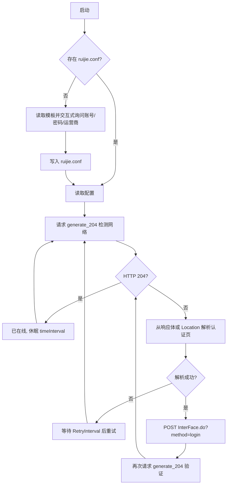

# 架构说明

## 1. 总体结构

```text
Autoconnect-38/
├── ruijie-login.ps1        # Windows PowerShell 主程序
├── ruijie.bat              # 双击启动入口
├── shell/                  # Linux / WSL Shell 版本
│   ├── ruijie-login.sh
│   ├── ruijie.conf.example
│   └── utils/
├── auto_login/             # 上游 Go 版本（未改动核心逻辑）
├── docs/                   # 架构、分支模型、图片
├── .github/                # Issue / PR 模板与 CI
├── CONTRIBUTING.md
├── CODE_OF_CONDUCT.md
├── SECURITY.md
├── CHANGELOG.md
└── LICENSE
```

## 2. 认证流程



## 3. 三个实现

| 实现 | 入口 | 适用平台 | 说明 |
| --- | --- | --- | --- |
| PowerShell | `ruijie-login.ps1` | Windows 10/11 | 本项目新增，零依赖，支持交互式初始化 |
| Shell | `shell/ruijie-login.sh` | Linux / WSL | 沿用上游实现，使用 `curl` 与配置文件 |
| Go | `auto_login/main.go` | 跨平台 | 上游实现，编译为单文件二进制 |

## 4. 关键设计

### 4.1 联网检测

使用 `generate_204` 类地址判断是否已认证：已在线时返回 `HTTP 204`；未认证时通常返回 `302` 并携带认证页地址。程序依次尝试多个检测地址，避免单一地址不可达导致误判。

### 4.2 认证页解析

优先读取响应头 `Location`，其次从响应体中提取包含 `index.jsp`、`eportal`、`InterFace.do` 的链接。解析后把 `index.jsp` 替换为 `InterFace.do?method=login`，并将查询串中的 `&`、`=` 再次编码，保证与 ePortal 的表单格式一致。

### 4.3 配置与日志

- 配置：`shell/ruijie.conf`，模板为 `ruijie.conf.example`，真实文件被 `.gitignore` 忽略。
- 日志：控制台彩色输出，同时追加写入 `log_path` 指定的文件。
- 密码：认证接口要求明文提交，因此本地配置文件中的密码为明文；文档中已明确提示风险。

### 4.4 跨平台换行

`.gitattributes` 强制 `*.sh`、`*.conf`、`*.go` 等文本文件使用 LF，避免 Windows 检出后 Shell 脚本出现 `\r` 导致无法执行。

## 5. 可扩展点

- 新增运营商：在 `serviceMap` 中增加名称与编码映射；
- 新增检测地址：修改 `$DetectUrls` 或通过 `-DetectUrl` 参数传入；
- 开机自启：将 `ruijie.bat` 的快捷方式放入 `shell:startup`；
- 其他校区适配：不同 ePortal 版本的登录字段可能不同，可在 Issue 中提供认证页结构。
